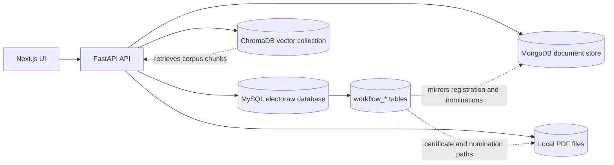
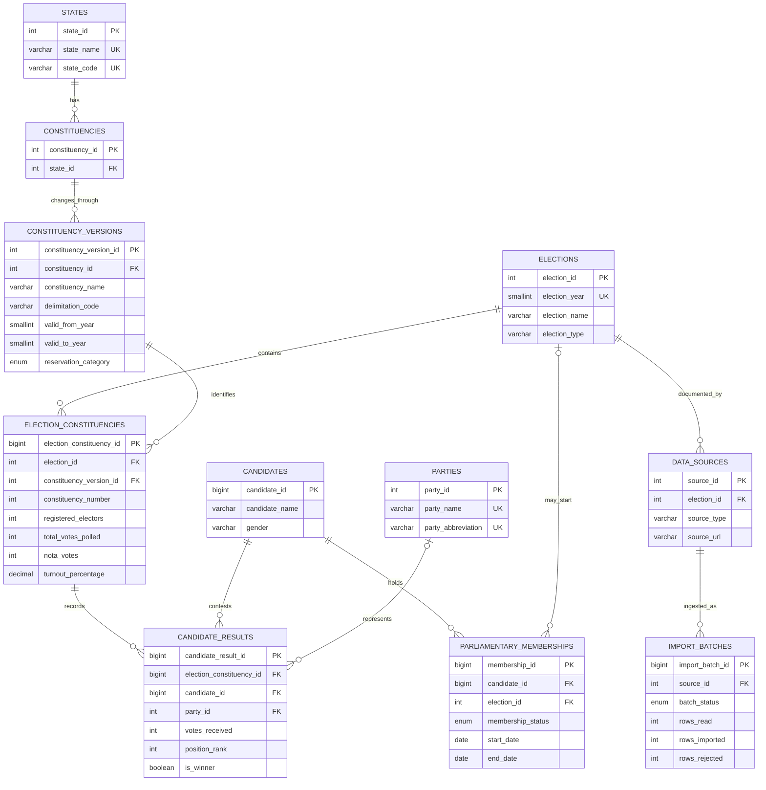
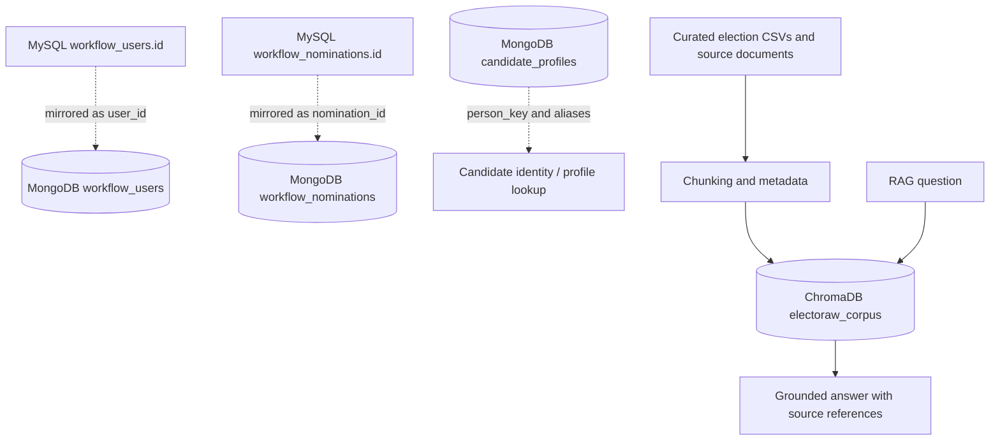

# ELECTORaW ER diagram and relationship schema

This document reflects the current repository design. ELECTORaW has two relational domains:

- MySQL is the normalized analytical schema and the runtime operational workflow database.
- The legacy SQLite file is a migration source only; new workflow operations use MySQL `workflow_*` tables.

MongoDB stores document mirrors and profile documents; ChromaDB stores RAG chunks and is not a relational model.

## 1. System-level storage relationship



## 2. Analytical election ER diagram — MySQL



### Analytical relationship schema

| Table | Primary key | Important foreign keys | Relationship / purpose |
|---|---|---|---|
| `states` | `state_id` | — | One state has many stable constituency identities. |
| `constituencies` | `constituency_id` | `state_id → states` | Stable identity independent of historical naming. |
| `constituency_versions` | `constituency_version_id` | `constituency_id → constituencies` | Name, delimitation period, and reservation category for a constituency. |
| `elections` | `election_id` | — | One election year and election definition. |
| `election_constituencies` | `election_constituency_id` | `election_id → elections`; `constituency_version_id → constituency_versions` | The seat as contested in one election. |
| `candidates` | `candidate_id` | — | Stable person identity; do not use name as the key. |
| `parties` | `party_id` | — | Party reference data. |
| `candidate_results` | `candidate_result_id` | contest, candidate, optional party | One candidate’s result in one seat; `is_winner` identifies the official winner row. |
| `parliamentary_memberships` | `membership_id` | candidate; optional election | Separates election victory from actual membership and verification. |
| `data_sources` | `source_id` | `election_id → elections` | Provenance registry for official files and URLs. |
| `import_batches` | `import_batch_id` | `source_id → data_sources` | Ingestion run and validation counts. |

## 3. Operational workflow ER diagram — MySQL workflow_* tables

```mermaid
erDiagram
    USERS ||--o{ ELECTIONS : declares
    ELECTIONS ||--o{ ELECTION_CONSTITUENCIES : opens_for
    USERS ||--o{ NOMINATIONS : submits
    ELECTIONS ||--o{ NOMINATIONS : receives
    USERS o|--o{ NOMINATIONS : reviews
    NOMINATIONS ||--o| CERTIFICATES : earns
    USERS ||--o{ CERTIFICATES : issues
    USERS o|--o{ AUDIT_LOG : performs

    USERS {
        text id PK
        text email UK
        text full_name
        text role "elector or officer"
        text phone
        text state
        text constituency
        text status
    }
    ELECTIONS {
        text id PK
        int year
        date election_date
        text title
        text scope "selected, state, all"
        text status "open, closed, deleted"
        text declared_by FK
        datetime declared_at
        datetime closed_at
    }
    ELECTION_CONSTITUENCIES {
        text id PK
        text election_id FK
        int year
        text state
        text constituency
    }
    NOMINATIONS {
        text id PK
        text election_id FK
        text candidate_user_id FK
        text state
        text constituency
        text candidate_name
        text party
        text status "pending, accepted, rejected"
        boolean is_winner
        json form_json
        datetime submitted_at
        datetime reviewed_at
        text reviewed_by FK
        text review_note
        text nomination_pdf_path
        datetime authenticated_at
    }
    CERTIFICATES {
        text id PK
        text nomination_id FK UK
        text candidate_user_id FK
        text certificate_number UK
        text pdf_path
        datetime issued_at
        text issued_by FK
    }
    AUDIT_LOG {
        text id PK
        text user_id FK
        text action
        text entity_type
        text entity_id
        json details_json
        datetime created_at
    }
```

### Workflow relationship schema

| Table | Primary key | Important foreign keys / constraints | Relationship / purpose |
|---|---|---|---|
| `users` | `id` | unique `email`; role check | Registration identity for electors/candidates and EC officers. |
| `elections` | `id` | `declared_by → users` | Officer-created declaration with entered election date and lifecycle status. |
| `election_constituencies` | `id` | `election_id → elections`; unique election/state/constituency | Materialized seats included by a declaration. |
| `nominations` | `id` | election, candidate user, reviewing officer → `users` | Candidate application, review state, winner flag, form JSON, approval PDF path. |
| `certificates` | `id` | unique `nomination_id`; candidate and issuing officer → `users` | One winner certificate per nomination. |
| `audit_log` | `id` | optional `user_id → users` | Reviewable record of declarations, reviews, approvals, winner decisions, and awards. |

## 4. Document and vector relationships

These stores are intentionally represented as logical relationships rather than SQL foreign keys.



- `workflow_users` and `workflow_nominations` are best-effort MongoDB mirrors; MySQL remains the transactional source for role workflow state.
- `candidate_profiles` contains profile/provenance documents and does not replace the relational `candidates` identity.
- ChromaDB stores embeddings and metadata for retrieval; it has no candidate/election foreign-key enforcement.
- PDF files are filesystem artifacts referenced by `nominations.nomination_pdf_path` and `certificates.pdf_path`.
- The nullable `nominations.digital_signature` column remains only for migration compatibility; current approval PDFs do not generate or display a digital signature. `authenticated_at` is the stored approval timestamp.

## 5. Core workflow rules

1. An officer declares an election and its included seats in one relational workflow.
2. An elector submits at most one nomination for a candidate/election/seat combination.
3. A nomination transitions `pending → accepted` or `pending → rejected`.
4. Only an accepted nomination can become a winner.
5. The partial unique winner index permits at most one winner per election/state/constituency.
6. Only an accepted winner can receive one certificate.
7. Acceptance creates a nomination PDF whose visible approval line is `Approved by Returning Officer: <name>`.
8. Every administrative transition is recorded in `audit_log` and mirrored nomination documents are updated in MongoDB when available.
